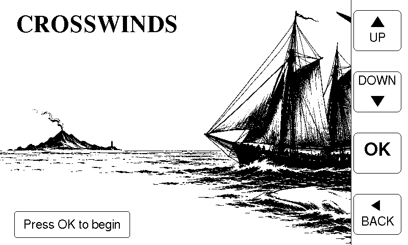
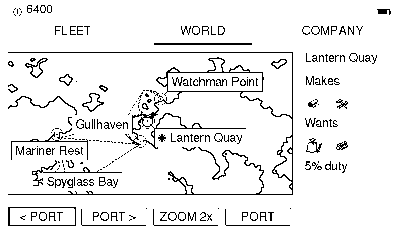
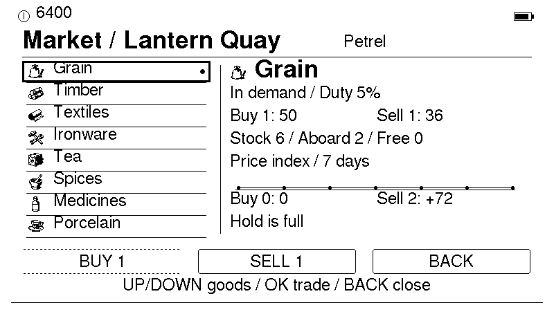
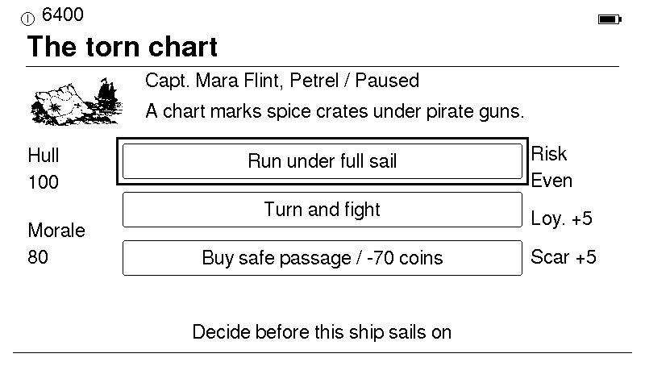

# Crosswinds

A maritime trading game for the Xteink X4 e-reader. Trade goods, deliver parcels, and manage a fleet.

Runs as standalone firmware. A [CrossPoint Reader version](https://github.com/terriblewitlogic/crosspoint-crosswinds) is also available.

<table>
  <tr>
    <td></td>
    <td></td>
  </tr>
  <tr>
    <td></td>
    <td></td>
  </tr>
</table>

## Controls

Hold the reader in landscape with the four front buttons on the right.

| Button | Action |
| --- | --- |
| Front buttons, top to bottom | UP, DOWN, OK, BACK |
| Side rocker | Previous or next port, ship, page, or tab |
| POWER | Save and shut down; short press enters standby while a ship is sailing |

BACK at the top level opens the menu. Voyages continue during standby.

## Install

Download the prebuilt firmware from [Releases](https://github.com/terriblewitlogic/crosswinds/releases/latest). No build required.

- **First install:** use `full.bin`. Replaces the reader firmware and resets saves.
- **Update Crosswinds:** use `app.bin`. Keeps existing Crosswinds saves.

[USB installation and backup instructions](docs/INSTALL.md) · [Build from source](docs/HARDWARE.md#build-and-flash)

USB flashing must be unlocked. Backup restoration has not been tested; standby battery draw and clock drift are unmeasured.

## Desktop

Requires `clang++`, `pkg-config`, SDL2, and LovyanGFX (`make -C tools/host deps`).

```sh
make play-x4    # run
make verify     # test
```

[MIT license](LICENSE) · [Credits](NOTICE) · [Art pipeline](docs/ART.md)

