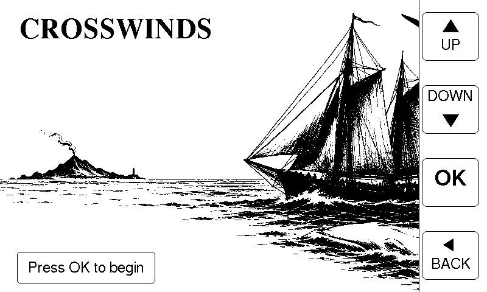
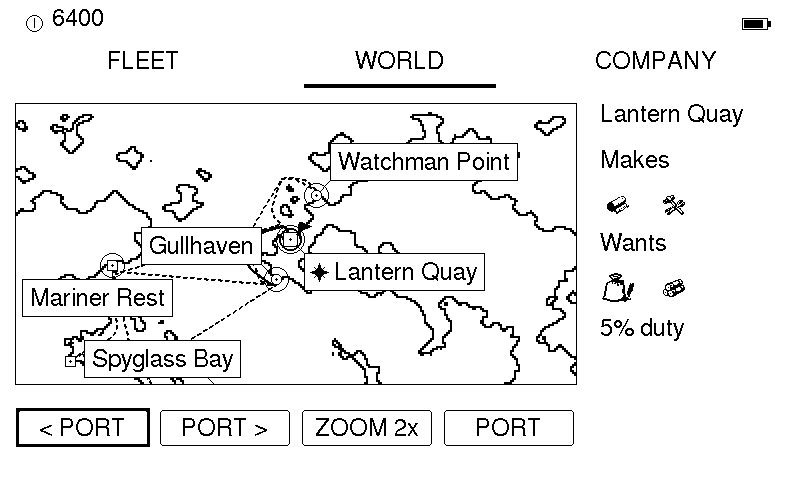
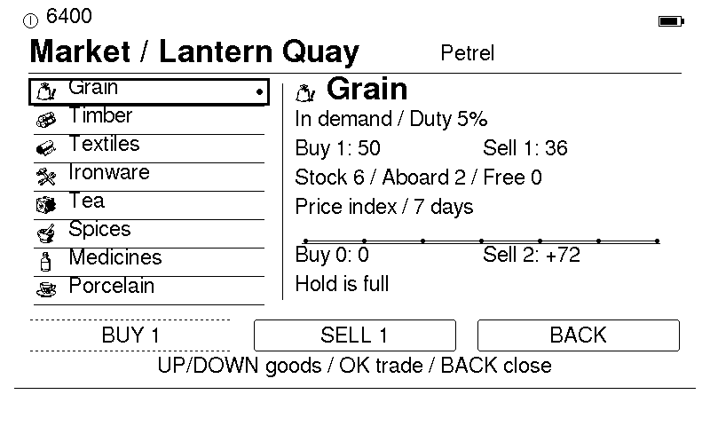
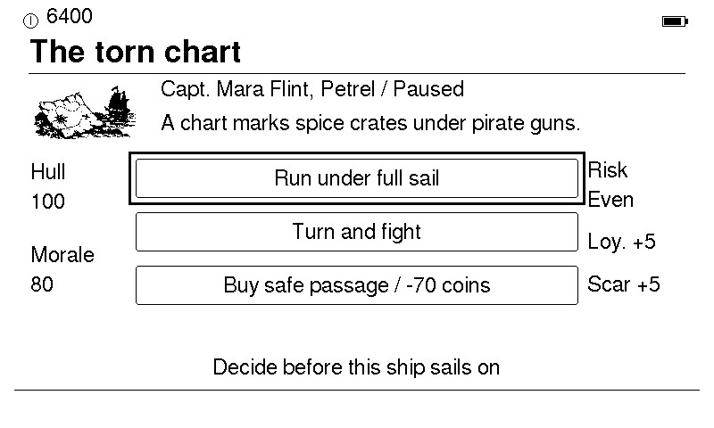

# Crosswinds

Crosswinds is a maritime trading game for the Xteink X4 e-reader. It is standalone firmware: it
replaces what is on the device rather than running inside a reader. If you would rather keep a
reader and have the game in its menu, there is a
[fork of CrossPoint Reader](https://github.com/terriblewitlogic/crosspoint-crosswinds) that
includes it.

<table>
  <tr>
    <td></td>
    <td></td>
  </tr>
  <tr>
    <td></td>
    <td></td>
  </tr>
</table>

## The game

You run a small fleet of ships in an invented sea, around 1810. Buy goods in one port, sail them to
another, and sell where they are wanted. Prices move with stock and demand. Sailing costs nothing,
and cargo stays aboard until you sell it. Parcels are optional, take one slot in the hold, and pay a
fixed reward on delivery. Captains, a port-by-port atlas and a recurring courier with seven story
parcels fill out the rest. A new company starts with a short guided voyage.

The game is played in landscape, with the reader turned so the four front buttons run down the right
edge of the screen. The Fleet, World and Company tabs along the top are reached with the side rocker.

| Button | Does |
| --- | --- |
| Front column, top to bottom | UP, DOWN, OK, BACK |
| Side rocker | previous or next port, ship, page or tab |
| POWER | save and power off, or standby while a ship is at sea |

BACK at the top level opens the ship's bell menu. While ships are at sea, a short POWER press puts
the reader in standby so voyages can finish; battery draw in standby has not been measured.

## Install

**This replaces the X4's firmware and partition table.** Back the device up first. If it came from a
third-party store with USB flashing locked, it cannot take this firmware until it is unlocked;
CrossPoint documents that situation at https://crosspointreader.com. A locked unit has not been tried.

### From source

You need `arduino-cli` with the Espressif `esp32` core 3.x (built here with 3.3.10) and LovyanGFX
1.2.24. `make -C tools/host deps` fetches LovyanGFX into `tools/host/vendor`.

```sh
make backup-x4 PORT=/dev/cu.usbmodem...    # full 16 MB flash backup, with a checksum
make upload-x4 PORT=/dev/cu.usbmodem...    # compile, back up, upload, then verify by reading back
```

`upload-x4` refuses to flash unless the compile and the backup both succeed. The board options and
the pin map are in [docs/HARDWARE.md](docs/HARDWARE.md).

### Going back

The backup is a plain 16 MB image. Writing it back at offset 0 with `esptool write-flash 0x0
flash.bin` should restore the device. That restore has not been tried with one of these backups.

## Status

The firmware is built from the same game code that was developed on a real X4. This repository was
assembled from that work by removing the older boards and the CrossPoint integration, and checking
that what remains compiles to the same X4 game. The build from this repository has been flashed to
one X4 that previously ran CrossPoint. It boots to the title, the front buttons work, and a company
survives a restart. That unit's saves area had to be erased first; the game formats it only when it
is completely blank.

Not measured: standby battery draw and clock drift, restoring a backup, and play on any unit other
than that one X4.

## Tests

The game also runs in a desktop window, and the tests drive it with scripted button presses. They
need `clang++`, `pkg-config` and SDL2.

```sh
make -C tools/host deps    # fetch LovyanGFX once
make play-x4               # open the game in a window
make verify                # all checks
```

## How it was made

Most of the code and in-game text was written with Claude Code and Codex, and the artwork was
generated with OpenAI's image tool and reduced to 1-bit. The maintainer directed the work and tested
it on a device. The development history is kept in a private repository; this one starts from a
single commit. [docs/ART.md](docs/ART.md) describes the art pipeline, and [NOTICE](NOTICE) lists the
credits.

## Licence

MIT, see [LICENSE](LICENSE). This is not affiliated with Xteink.
